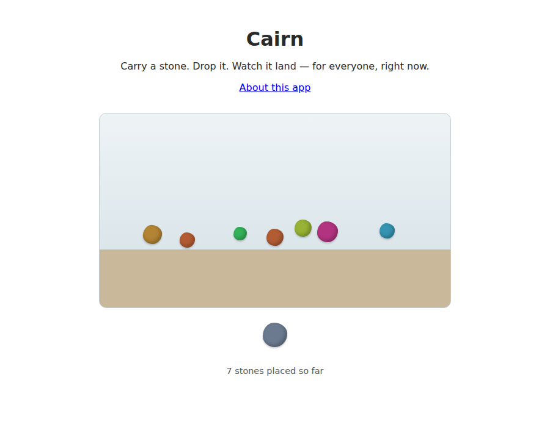

# Cairn

Cairn is one shared pile of stones. Open it, drag the stone at the bottom onto
the pile, and watch it land — for you, and for everyone else looking at the
same page, at the same moment. There are no accounts, no rooms, no score.
Just a cairn that a room full of people can build together, one stone at a
time, and that's still there tomorrow.

## What "good" means here

Good means the four things the brief and crit ask for are true, and checked,
not just claimed: a stone someone drops is visible on every other open
session within about a second; what gets dropped survives a restart or
redeploy; two visitors can tell their stones apart without signing up for
anything; and who may see and change what is decided by the server, never
assumed from whatever a client claims. `spec/invariants.test.ts` and
`spec/cairn.test.ts` enforce this against the running `/ws` protocol:
broadcast, persistence, malformed input rejected, two cookie jars told apart,
a tampered cookie never becoming someone else's, a forged `visitorId` or
`mine` field ignored, and no stone ever movable, editable, or deletable by
anyone. `spec/logging.test.ts` checks a placement's log line names the
visitor by pseudonym, never by cookie id. In one sentence: everyone sees
every stone, only its real owner is told "this is yours," and each visitor
may place one stone per Canberra day
(`docs/adr/0004-who-may-see-and-change-what.md`). Whether the *interaction*
is actually good — satisfying to drop, or reading as "someone's here" rather
than a notification — isn't something a test can decide. I judged that
myself, from two browser windows side by side.

## What I read while deciding

Robin Sloan's [*An App Can Be a Home-Cooked
Meal*](https://www.robinsloan.com/notes/home-cooked-app/) argues for sizing
software to its real audience instead of defaulting to "professional,
scalable" infrastructure. Cairn's audience is a crit room, and the brief's
single 256MB machine agrees with that framing: one Node process, one SQLite
file, no accounts, nothing extra to operate.

Ink & Switch's [*Local-first
software*](https://www.inkandswitch.com/essay/local-first/) makes a real case
for CRDTs and offline-capable apps that outlive any one server. I read it and
didn't follow it: Cairn only ever appends a new stone to a shared pile, which
never conflicts, so a single authoritative server is simpler than a merge
algorithm for a problem this app doesn't have. That's a trade-off I'm naming,
not one I missed.

Dourish & Bellotti's *Awareness and Coordination in Shared Workspaces* (CSCW
'92) is why there's no visitor list, no names, no "X is online" banner. They
found that awareness picked up passively through a shared object — rather than
announced separately from it — lets people move fluidly between paying close
attention and barely noticing each other. A colored stone landing *is* the
presence signal here — carrying one toward the pile stays on your own screen,
so the only thing anyone else sees is a stone actually placed, not a change of
mind about one; see `docs/adr/0002-visitor-identity.md` and
`docs/adr/0003-carry-stays-local.md`.

## What I chose not to build

No moderation, no way to remove a stone, no multiple rooms, no cap on how
large the pile can grow, no chosen names, no visible cursors or in-progress
drags. Each is a real, small feature; none
of them were needed to make the three required properties true, and each would
have added a decision — who moderates, what happens once the pile is "too big"
— that nothing here asked me to make yet. `docs/adr/` has the reasoning behind
the two decisions that mattered most: the stack, and what counts as a visitor.

