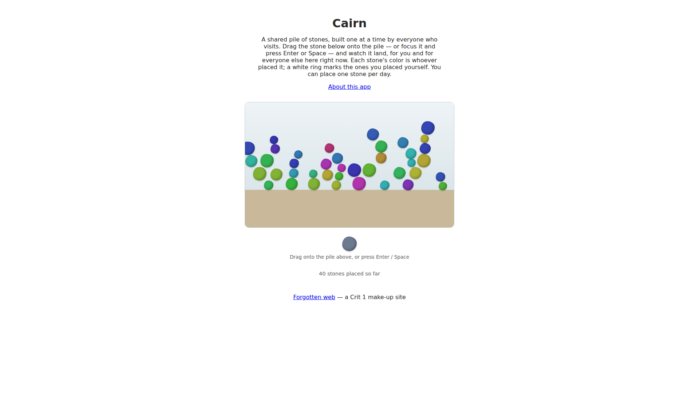

# Cairn

Cairn is one shared pile of stones. Open it, drag the stone at the bottom onto
the pile, and watch it land — for you, and for everyone else looking at the
same page, at the same moment.

## What "good" means here

A room of people builds one thing together, and every stone on the pile
means someone was actually there and chose where to leave it. One stone a
day makes you think about where to put it, at the cost that clearing
cookies or switching browsers gets around it. Stones that can never move or
be deleted mean a cairn you can trust will still hold your stone tomorrow.
Colour instead of a name means nobody waits at a sign-up box before their
first stone. Testing the live deployment the way a marker would taught me
that good isn't proven by green checks — it's proven by checks I've seen go
red for the right reason.

## Who it's for

Cairn is for a small group in the same place at the same time: a crit pod,
a room full of people at a showcase. You notice the others through the
pile itself — a new colour arrives, a stone lands on top of yours.

## What I read while deciding

Robin Sloan's [*An App Can Be a Home-Cooked
Meal*](https://www.robinsloan.com/notes/home-cooked-app/) gave me
permission not to build for scale: Cairn is for a crit room, so I picked
the smallest stack that works.

Ink & Switch's [*Local-first
software*](https://www.inkandswitch.com/essay/local-first/) makes a real
case for CRDTs, and I read it and didn't follow it: in Cairn people only
ever add new stones, never change an existing one, so there's nothing to
merge.

Dourish & Bellotti's *Awareness and Coordination in Shared Workspaces*
(CSCW '92) is why there's no visitor list, no names, no "X is online"
banner, and why carrying a stone stays on your own screen until it's
dropped.

## What I chose not to build

No accounts or names, no moderation, no way to move or delete a stone, no
multiple rooms, no live cursors or showing a stone while still carried, no
likes or scores, no cap on the pile. Each one would change what Cairn is.

## Which claims are enforced and which are judged

| Claim | How it's held |
| --- | --- |
| `/` and `/readme/` render, and link back | `invariants.test.ts` |
| Broadcasts within ~1s; no cap on pile size | `cairn.test.ts`, `pile-size.test.ts` |
| Carry stays local; only drops broadcast | `cairn.test.ts` |
| Survives a restart or redeploy | `persistence.test.ts` |
| Told apart by server cookie, never what the browser sends | `cairn.test.ts` |
| Bad input dropped silently, no crash | `cairn.test.ts` |
| Stones never move, edit, or delete | `cairn.test.ts` |
| One stone per Canberra day | `cairn.test.ts`, `canberra-date.test.ts` |
| Logs use pseudonym, never cookie id | `logging.test.ts` |
| Same pile at every viewport | `pile-layout.browser.test.ts` |
| Clean "Reconnecting…", no duplicate stones | `connection-status.browser.test.ts`, `reconnect.browser.test.ts` |
| Feels satisfying to drop | Judged: by me, two browser windows side by side |
| Reads as "someone's here" | Judged: by me, two browser windows side by side |
| Works the way a marker uses it | Judged: live marker pass, `docs/testing/final-marker-pass.md` |
| No rooms, no moderation | Judged: deliberate absence |

## What's still rough

- One stone a day is tied to a cookie, so clearing cookies gets around it.
- Colour is the only way to tell people apart, and some colours look alike.
- Enter/Space always drops the stone in the middle of the pile.
- Cairn assumes one machine; running two would show people different piles.
